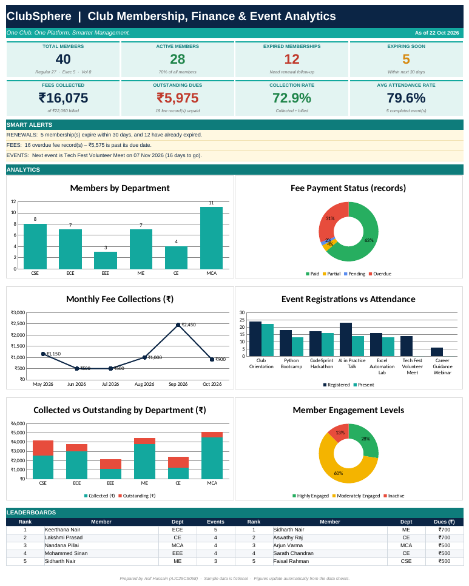
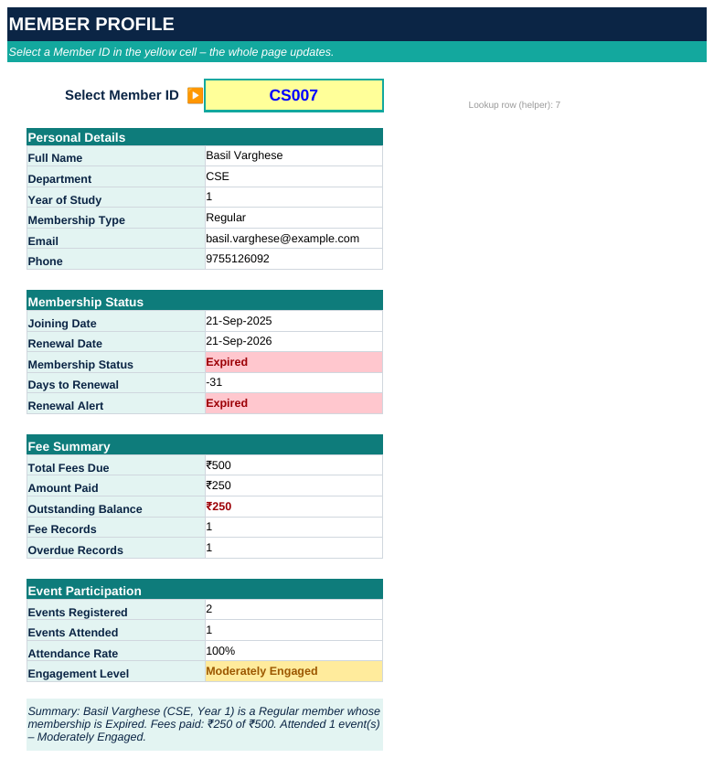
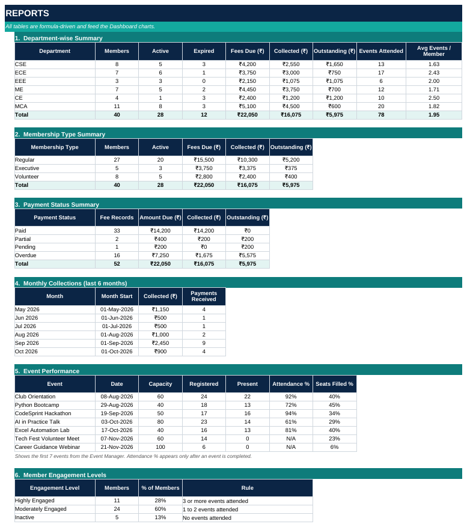

# ClubSphere

### Smart Club Membership, Finance & Event Analytics System

*One Club. One Platform. Smarter Management.*


ClubSphere turns Microsoft Excel into a small administration and analytics system for a college club. Members, fees, events and attendance are linked through unique IDs, formulas calculate every status and total automatically, and a dashboard shows the results on one screen. A Microsoft Word mail merge extension uses the same data to produce personalised letters and ID cards.

> **Mini Project, 24MNC201 Essentials of Office Automation** (Individual, 40 marks)
> Amal Jyothi College of Engineering (Autonomous), Kanjirapally
> **Author:** Asif Hussain, AJC25CS058, B.Tech Computer Science and Engineering



---

## The problem

A club coordinator has to answer questions such as:

- How many members are active, expired or about to expire?
- Who has paid, who owes money, and which payments are overdue?
- Which events were well attended, and which departments take part most?
- Can any member's details be found instantly?

When records live in separate lists, every answer needs manual work and mistakes are easy to make. ClubSphere links all records in one workbook so the answers update by themselves.

## Features

- **Automatic membership status:** renewal date, Active / Expired status, days to renewal and a 30-day "Expiring Soon" alert.
- **Fee management:** balance, Paid / Partial / Pending / Overdue status and days overdue.
- **Events and attendance:** registrations, present and absent counts, attendance % and seat-fill %.
- **Member Profile:** pick a Member ID to see a one-page summary of that member.
- **Reports:** department, membership type, payment status, monthly collections, event performance and engagement levels.
- **Dashboard:** 8 KPI cards, 3 smart alerts, 6 charts and Top 5 leaderboards.
- **Error prevention:** dropdown lists, unique-ID rule, date and amount rules, colour-coded statuses and data bars.
- **No macros, no VBA:** only built-in Excel features.

## Workbook structure

| Sheet | Purpose |
|---|---|
| Dashboard | KPI cards, smart alerts, charts and leaderboards |
| Member Register | Master member records with calculated renewal status |
| Fee Tracker | Fee records with balance, payment status and days overdue |
| Event Manager | Events with registrations, attendance % and status |
| Attendance | One row per member-event registration |
| Member Profile | Dropdown-driven one-page member lookup |
| Reports | Six formula-driven summary tables that feed the charts |
| Read Me | Usage guide, colour code and assumptions |
| Lists | Dropdown lists and settings (report date, alert window, validity) |

**How the sheets link:** Member ID connects the Member Register, Fee Tracker and Attendance. Event ID connects the Event Manager and Attendance. Reports summarise the data sheets, and the Dashboard reads from the Reports.

## Excel features used

| Feature | Used for |
|---|---|
| `EDATE`, `IF`, `IFERROR` | Renewal date, status and safe lookups |
| `COUNTIFS`, `SUMIFS` | Counts and totals by department, type, status and month |
| `INDEX` + `MATCH` | Retrieve names and details from an ID (works in every Excel version) |
| `LARGE` + `MATCH` | Top 5 leaderboards |
| Data validation | Dropdowns, unique IDs, date and amount rules |
| Conditional formatting | Status colours and data bars |
| Charts | Column, doughnut, line, clustered and stacked charts |
| Named cells | `ReportDate`, `AlertDays`, `ValidMonths` |

Example formulas:

```excel
Renewal Date      =IF(H5="","",EDATE(H5,ValidMonths))
Membership Status =IF($A5="","",IF(I5="","Not Set",IF(I5<ReportDate,"Expired","Active")))
Balance           =G5-H5
Payment Status    =IF(K5<=0,"Paid",IF(I5<ReportDate,"Overdue",IF(H5>0,"Partial","Pending")))
```

## Sample data and results

All data is **fictional**: 40 members from six departments, 52 fee records, 7 events and 118 attendance records. The report date is fixed at **22 October 2026** so that every figure matches the documentation.

| Indicator | Result |
|---|---|
| Total members | 40 (28 active, 12 expired, 5 expiring soon) |
| Fees collected | ₹16,075 of ₹22,050 billed (72.9%) |
| Outstanding dues | ₹5,975 |
| Average event attendance | 79.6% |

| Member Profile | Reports |
|---|---|
|  |  |

## Word mail merge extension (ClubSphere Connect)

The same membership data is prepared as an Excel data source and merged with four Word main documents.

| Document | Data sheet | Records |
|---|---|---|
| Membership confirmation letters | Members_All | 40 |
| Renewal reminders (expired or expiring soon) | Renewal_Due | 17 |
| Fee payment notices (balance due) | Fee_Due | 16 |
| Membership ID cards (8 per page) | Members_All | 40 (5 pages) |

The merged output is available as Word and PDF files in [`05_Word_MailMerge_Extension`](05_Word_MailMerge_Extension). To run the merge yourself, follow `How_to_run_the_mail_merge.txt` in that folder (Mailings > Select Recipients > Use an Existing List).

## Testing

The workbook was tested by changing data in a copy, recalculating and comparing the output.

| Test | Result |
|---|---|
| Mark overdue fee FEE005 as paid | Status becomes Paid; collected ₹16,075 → ₹16,225 |
| Add new member CS041 | Renewal date and status fill automatically; members 40 → 41 |
| Select Member ID CS012 | Profile updates to that member |
| Change report date to 1 Dec 2026 | Expired 12 → 18, active 28 → 22 |

The mail merge was checked so that every record produced exactly one document, every name appeared, and no field codes remained.

## Repository contents

```
ClubSphere/
├── README.md
├── 01_Project_Proposal/            Proposal (Word and PDF)
├── 02_Working_Prototype/           ClubSphere_Working_Prototype.xlsx
├── 03_Project_Documentation/       Final report (Word and PDF, AJCE format)
├── 04_Presentation/                ClubSphere_Presentation.pptx
├── 05_Word_MailMerge_Extension/    Data source, main documents, merged output
└── screenshots/                    Images used in this README
```

## How to use

1. Download `02_Working_Prototype/ClubSphere_Working_Prototype.xlsx` and open it in desktop Microsoft Excel (click **Enable Editing** if prompted).
2. Start on the **Dashboard**. Change a payment in the **Fee Tracker** and watch the totals update.
3. Pick a Member ID on **Member Profile** to see an individual summary.
4. To add records, unhide the spare rows (select the rows around the gap, right-click, **Unhide**) and type in the blue columns. Black columns are formulas.
5. To get live alerts, type `=TODAY()` in `Lists!J2`.

## Limitations

- Sized for 100 members, 150 fee records, 20 events and 300 attendance rows.
- One user at a time; no automatic emails or reminders.
- The Dashboard charts need desktop Excel to display; some online previewers do not render them.

## Future scope

- PivotTables and slicers for interactive analysis
- Expense tracker and event budget analysis
- Printable membership cards and fee receipts
- Personalised email merge and a shared online workbook

## Video presentation

Add the Google Drive link to the recorded video here: `<video link>`

---

*Prepared for academic purposes. All names, contact details, amounts and dates are fictional sample data.*
